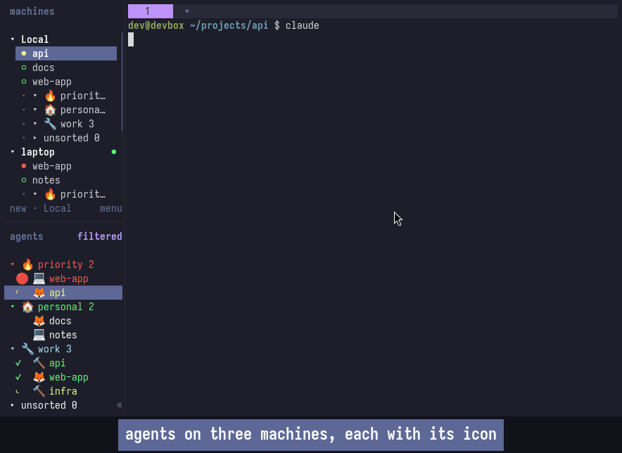

# herdr-machine-icons

A [herdr](https://herdr.dev) plugin: every pane on a machine carries that machine's icon as the pane token
`machine_icon`, so herdr's sidebar can show which machine an agent runs on in one character instead of its name.



One herdr window with agents on devbox 🦊, laptop 💻 and buildbox 🔨, grouped by queue with
[herdr-queues](https://github.com/Benjmhart/herdr-queues) (its label `{machine} {workspace}`); a click switches to the
agent on its machine. (Made-up machines in a throwaway herdr.)

```toml
# ~/.config/herdr/config.toml
[ui.sidebar.agents]
rows = [["state_icon", "$machine_icon", "workspace", "tab"]]
```

## Install

    herdr plugin install Benjmhart/herdr-machine-icons

on every machine herdr reaches, and give each the same icon list, one `<hostname> <icon>` per line
(`#` starts a comment):

    # $(herdr plugin config-dir benjmhart.machine-icons)/icons
    devbox   🦊
    laptop   💻
    buildbox 🔨

The hostname is `uname -n` up to the first dot. A machine with no line gets no token, so its agents show none.


### Windows

Runs on herdr's Windows build (tested on Windows 11, herdr 0.9.5). Windows' own `python3` is a Microsoft Store
stub: install Python with python.org's **Python install manager**, which answers to `python3`. The icons file is `%APPDATA%\herdr\plugins\config\benjmhart.machine-icons\icons`.

## How

Each machine tags its own panes, so no machine needs to reach another: at server start and whenever a pane or an agent
appears, `machine_icons.py` sets `machine_icon` on every pane of that server (`herdr pane report-metadata`). herdr does
not keep pane tokens across a restart; the startup hook puts them back. Change the list, then restart the server or open
a pane for it to apply.

Standard library Python 3 only. Linux, macOS and Windows.

## Test

    python3 machine_icons.py test

CI (`.github/workflows/ci.yml`) runs the tests on Linux, macOS and Windows and links the plugin into a real herdr on every push. Tag a release only from a commit whose run is green.
